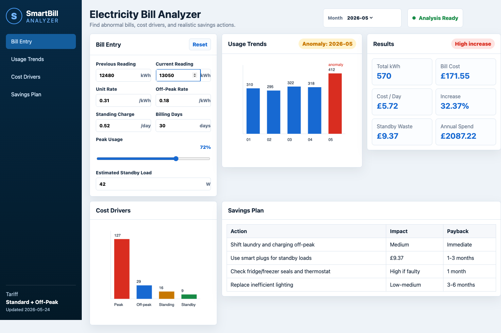
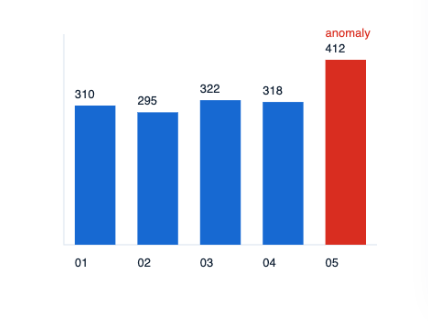

# SmartBill Analyzer

SmartBill Analyzer is a practical electricity bill analysis tool for households
and small businesses. It helps users understand usage spikes, standby waste,
peak/off-peak cost drivers, and simple savings actions.

## Features

- Bill reading entry and tariff inputs
- Monthly usage trend chart with anomaly marker
- Total kWh, bill cost, cost per day, annual spend projection
- Standby-waste estimate
- Cost-driver chart
- Savings recommendation table
- CSV report export
- Tested Python calculation layer
- GitHub Actions CI

## Screenshots

Dashboard:



Usage trend graph:



## Run

```bash
python3 -m http.server 5176
```

Then open:

```text
http://127.0.0.1:5176
```

## Test

```bash
python3 -m unittest discover -s tests -v
```

## Export Report

```bash
PYTHONPATH=. python3 tools/export_sample_report.py
```

## Author
Ansari Sufiyan

